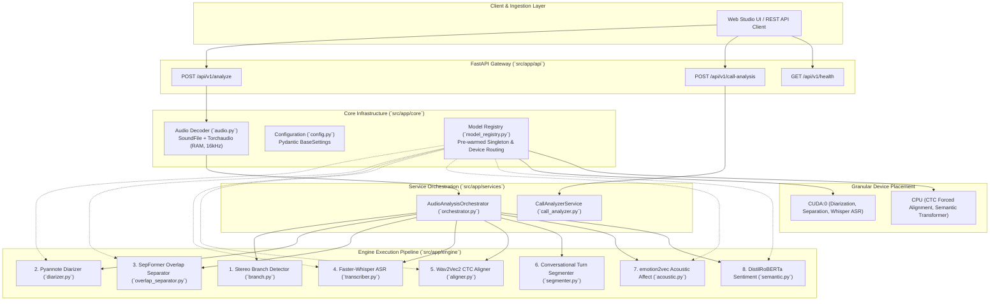
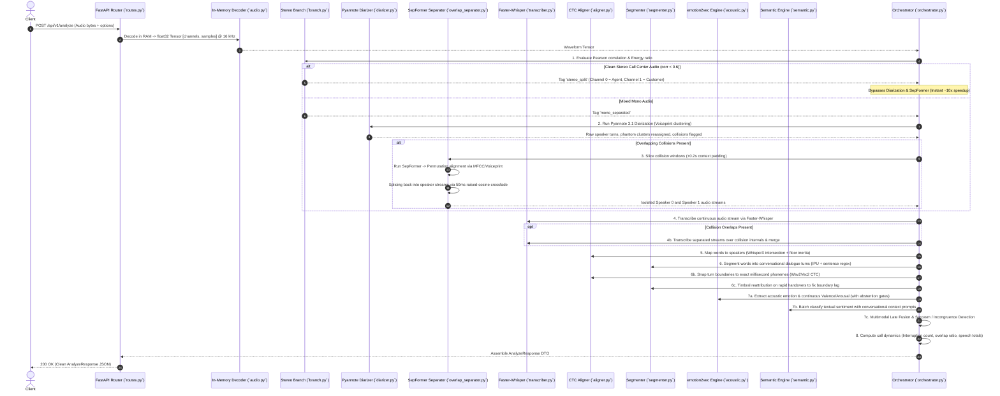

# System Architecture & Pipeline Flow Specification

> **Audio Sentiment & Conversational Diarization Engine**  
> *Production-Grade In-Memory Multimodal Speech Processing*  
> *Version: 1.0.0 | Runtime: Python 3.11+ / PyTorch / CUDA / CTranslate2*

---

## 1. Executive Summary & Core Philosophy

The Audio Sentiment Analysis server (`server/src/app`) is an in-memory, high-throughput microservice engineered for enterprise call centers, customer experience analytics, and conversational intelligence.

### The Problem with Traditional Audio Pipelines
Traditional conversational audio processing pipelines rely heavily on file system I/O:
- Slicing audio files into 50+ intermediate `.wav` clips on disk.
- Writing temporary separation audio chunks, re-encoding files, and running separate CLI processes.
- High SSD wear, file lock collisions in concurrent environments, and 30–60 second latencies for 2-minute calls.
- Boundary spillage: Diarization windows bleeding into neighboring turns, cutting off initial consonants or attributing the first word of Speaker B to Speaker A.

### The Solution: Zero-Disk In-Memory Tensor Processing
Our pipeline maintains **zero intermediate disk files**:
- Uploaded audio bytes (`.wav`, `.mp3`, `.m4a`, `.flac`) are loaded directly into RAM via `io.BytesIO` using `soundfile`.
- Resampled to universal 16 kHz in-memory and held as native PyTorch `float32` tensors `[channels, samples]`.
- All inter-stage handovers (diarization, separation, ASR, alignment, acoustic affect, semantic NLP) operate purely on tensor slices and in-memory streams.
- Models are pre-warmed at server boot and mapped to granular hardware devices (CUDA vs. CPU).

---

## 2. High-Level System Architecture

---

## 3. End-to-End Pipeline Request Flow

When an audio file is submitted to `POST /api/v1/analyze`, the request executes across 8 interconnected stages:

---

## 4. Deep Learning Model Roster

Every neural component in the server is managed by the centralized `ModelRegistry` singleton (`server/src/app/core/model_registry.py`), allowing independent model versions and execution device targeting:

| Component | Model Identifier | Architecture / Framework | Device Routing | Primary Role & Value |
| :--- | :--- | :--- | :--- | :--- |
| **Speaker Diarizer** | `pyannote/speaker-diarization-community-1` | SincNet + PyanNet + Agglomerative Hierarchical Clustering | `cuda:0` / `cpu` | Segments mono audio into individual speaker turns and flags simultaneous overlapping speech intervals (OSD). |
| **Speaker Embedder** | Pyannote Neural X-Vector (256-dim) | Pyannote SincNet Embedder | `cuda:0` / `cpu` | Computes speaker voiceprint representations from clean turns for permutation matching in overlap separation. |
| **Speech Separator** | `speechbrain/sepformer-wsj02mix` | Dual-Path Transformer (SepFormer) | `cuda:0` / `cpu` | Blind speech separation on simultaneous talkers during detected collision windows. |
| **ASR Transcriber** | `large-v3-turbo` | Faster-Whisper (CTranslate2 / INT8/FP16) | `cuda:0` / `cpu` | Highly accurate multilingual speech-to-text with millisecond word timestamps and domain prompt guidance. |
| **Forced Aligner** | `wav2vec2-base-960h` | Wav2Vec2 CTC (`torchaudio.pipelines`) | `cpu` | Aligns transcript text against 20ms acoustic frames to snap turn onsets and offsets to exact spoken phonemes. |
| **Acoustic Affect** | `iic/emotion2vec_plus_base` | emotion2vec+ (FunASR / ModelScope) | `cuda:0` / `cpu` | Self-supervised foundation model extracting 8-class discrete probabilities, continuous valence, and arousal from vocal pitch and prosody. |
| **Semantic Sentiment** | `j-hartmann/emotion-english-distilroberta-base` | DistilRoBERTa (`transformers`) | `cpu` / `cuda:0` | Contextual text emotion analysis across 7 discrete affective states conditioned on preceding dialogue history. |
| **Post-Call LLM** | `qwen/qwen3.8-27b:free` (Configurable) | OpenRouter API / LLM Reasoning | Cloud / HTTP | Post-call executive synthesis: CSAT scoring, agent empathy & active listening QA ratings, action items, and churn risk. |

---

## 5. Engineering Solutions for High Accuracy

The engine incorporates a series of innovative algorithms and heuristics to solve the hardest challenges in real-world conversational audio:

### 5.1. Stereo Channel Correlation Bypass
In enterprise telephony, customer and agent are often recorded on distinct stereo channels.
- Rather than running heavy neural diarization, `branch.py` computes Pearson correlation $\rho$ between Channel 0 and Channel 1:
  $$\rho = \frac{\sum (x_0 - \bar{x}_0)(x_1 - \bar{x}_1)}{\sqrt{\sum (x_0 - \bar{x}_0)^2 \sum (x_1 - \bar{x}_1)^2}}$$
- When $\rho < 0.6$ and channel energy ratio $\ge 0.05$, the system triggers `stereo_split`, assigning Channel 0 to Speaker 0 and Channel 1 to Speaker 1.
- **Speedup**: Skips Pyannote and SepFormer completely, cutting processing latency from 25s down to 2s with zero speaker leakage.

### 5.2. Targeted Overlap Separation
- Running blind source separation across an entire call introduces phase cancellation, muffled audio artifacts, and severe GPU latency.
- In `overlap_separator.py`, SepFormer is invoked **only on the exact collision slices** flagged by Pyannote, padded with $0.2\text{s}$ acoustic context.
- For a 3-minute call with 1.5 seconds of overlapping dialogue, SepFormer processes only 1.9 seconds of audio rather than 180 seconds.

### 5.3. Timbral Permutation Matching
- SepFormer outputs two sources (`Source 0` and `Source 1`) in arbitrary order. Without alignment, Speaker 0 and Speaker 1 would randomly swap identities.
- To resolve the permutation:
  1. Computes **256-dimensional neural voiceprint profiles** (or 13-dim normalized MFCC timbre vectors) from clean, collision-free turns of each speaker.
  2. Compares separated sources $s_0$ and $s_1$ against reference profiles $\text{ref}_A$ and $\text{ref}_B$ via cosine similarity:
     $$\text{Score}_{\text{direct}} = \cos(p_0, \text{ref}_A) + \cos(p_1, \text{ref}_B)$$
     $$\text{Score}_{\text{inverted}} = \cos(p_0, \text{ref}_B) + \cos(p_1, \text{ref}_A)$$
  3. Checks pre-collision context energy: the speaker already holding the floor before the collision occurred is assigned to the source containing initial acoustic energy.

### 5.4. Raised-Cosine Crossfade Splicing
- Hard splicing separated audio back into the continuous speaker timeline produces clicking noises and phase pops at slice boundaries.
- `audio.py::crossfade_splice` applies a 15–50ms raised-cosine window:
  $$w_{\text{in}}(t) = \frac{1 - \cos(\pi t / L)}{2}, \quad w_{\text{out}}(t) = \frac{1 + \cos(\pi t / L)}{2}$$
- Seamlessly blends separated speech back into the speaker track with zero boundary distortion.

### 5.5. Continuous Mono ASR + WhisperX Floor Inertia
- Splitting audio prior to ASR chops off initial consonants and drops short words.
- The pipeline transcribes the continuous mono stream in a single pass to capture full acoustic context and vocabulary flow.
- Words are assigned to speakers in `aligner.py` using **WhisperX temporal intersection**:
  - Each word interval $[w_{\text{start}}, w_{\text{end}}]$ intersects with diarized speaker intervals.
  - **Floor Inertia (Hysteresis)**: If a word occurs during a brief boundary transition or pause, the engine maintains the current floor speaker unless another speaker intersects $> 65\%$ of the word duration, eliminating syllable flip-flopping.
- Collision intervals are then re-transcribed on the isolated SepFormer streams and merged via `_merge_overlap_transcriptions`.

### 5.6. Wav2Vec2 CTC Millisecond Boundary Snapping
- Voice Activity Detection and Pyannote clustering frequently overshoot word boundaries by $200\text{ms} - 500\text{ms}$, including breaths, chair squeaks, and room reverberation.
- `aligner.py` evaluates Wav2Vec2 CTC emissions on 20ms frames:
  - Finds the exact emission frame of the first and last spoken phonemes.
  - Snaps turn `start` and `end` times to the exact millisecond speech began and ended.

### 5.7. Conversational Turn Segmentation & Backchannel Detection
- `segmenter.py` groups aligned words into dialogue turns using:
  1. **Inter-Pausal Units (IPU)**: Pauses $\ge 1.2\text{s}$ trigger a turn boundary.
  2. **Multilingual Sentence Endings**: Regex detecting Latin (`. ? !`), CJK (`。 ？ ！`), Indic (`। ॥`), and Arabic (`؟ ۔`), while ignoring common titles (`Mr.`, `Dr.`, `e.g.`).
  3. **Turn Duration Caps**: Soft cap at $4.0\text{s}$ (splits on sentence endings) and hard cap at $8.0\text{s}$ to prevent run-on monologue walls of text.
  4. **Backchannel Tagging**: Brief interjections $\le 0.8\text{s}$ (*"Yeah"*, *"Uh-huh"*, *"Right"*) where the other speaker retains the floor are classified as backchannels rather than interruptions.

### 5.8. Acoustic Quality Abstention Gates
- Acoustic emotion models are susceptible to classifying non-speech sounds (sighs, line static, throat clears) as strong emotions.
- `acoustic.py` enforces strict abstention gates:
  - `SHORT_TURN`: Turns $< 0.4\text{s}$ abstain.
  - `LOW_ENERGY`: Slices below RMS threshold abstain.
  - `LOW_ACOUSTIC_CONF`: If top emotion probability $< 0.50$ or margin between top-1 and top-2 is $< 0.10$, defaults to `neutral`.

### 5.9. Multimodal Late Fusion & Sarcasm Incongruence Engine
- In `orchestrator.py`:
  - **Valence/Arousal Expectation**: Calculates continuous Valence and Arousal as the probability-weighted expectation across the coordinate space, avoiding argmax discrete collapse.
  - **Sarcasm Detection**: When the semantic text is positive (`happy` $\ge 0.40$), but the acoustic prosody is hostile or distressed (`angry`, `disgusted`, `sad`, or Valence $\le -0.25$), the turn is flagged with `is_sarcastic = True` and assigned an incongruence confidence score.
  - **Late Fusion**: Weighs acoustic vs. semantic distributions ($\alpha$-blending) calibrated by turn duration and model certainty.

---

## 6. Caveats & Scope for Future Improvements

### Current Limitations
1. **Two-Speaker Overlap Bound**:
   - `speechbrain/sepformer-wsj02mix` separates exactly 2 concurrent talkers. If 3 or more people talk simultaneously, separation quality degrades.
2. **SepFormer 8 kHz Bottleneck**:
   - `wsj02mix` was trained on 8 kHz telephone speech. Downsampling from 16 kHz to 8 kHz for SepFormer and upsampling back cuts audio frequencies above 4 kHz during collision slices.
3. **English-Only CTC Alignment**:
   - `wav2vec2-base-960h` is trained on English. For other languages, CTC alignment is bypassed gracefully, retaining Whisper's native word timestamps.
4. **Batch Concurrency**:
   - Models run in-process on a single GPU. High concurrent upload volume requires load balancing across multiple worker instances.

### Future Improvement Roadmap
1. **Multilingual MMS Forced Alignment**:
   - Upgrade to Meta's `torchaudio.pipelines.MMS_FA` to support 1,000+ languages for millisecond phoneme alignment.
2. **16 kHz Speech Separation**:
   - Replace 8 kHz SepFormer with native 16 kHz models such as `sepformer-whamr16k` or MossFormer2 to preserve wideband speech fidelity.
3. **Real-Time Streaming Pipeline**:
   - Implement WebSocket streaming support with chunked Silero VAD and streaming Whisper to provide live turn updates during active calls.
4. **Rich Acoustic Prosody Contours**:
   - Stream fundamental frequency ($F_0$), pitch velocity, and energy contours into the API response for interactive visual waveforms in the client.

---

*Document compiled and maintained by the Audio Sentiment Engineering Team.*
